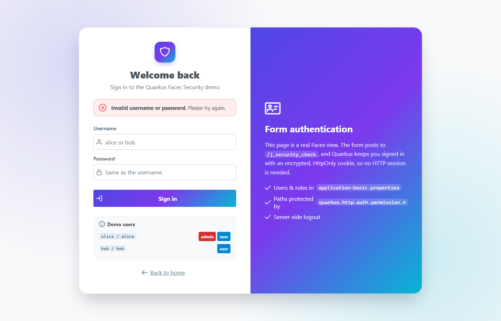
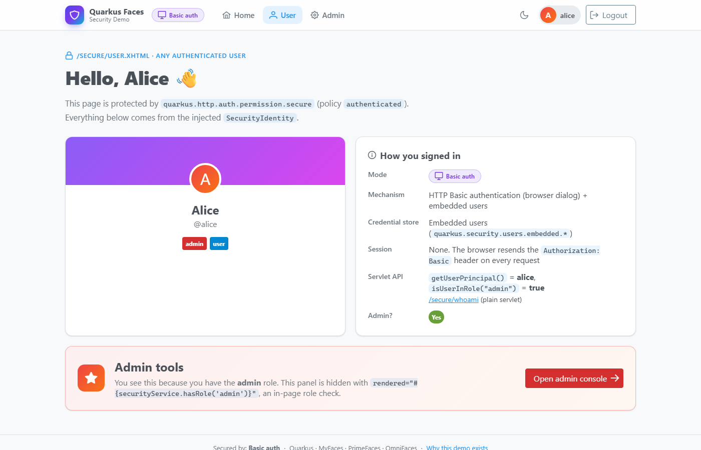
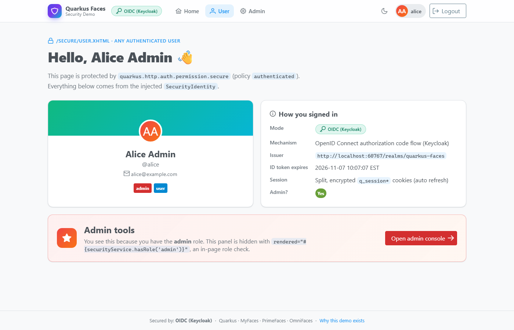
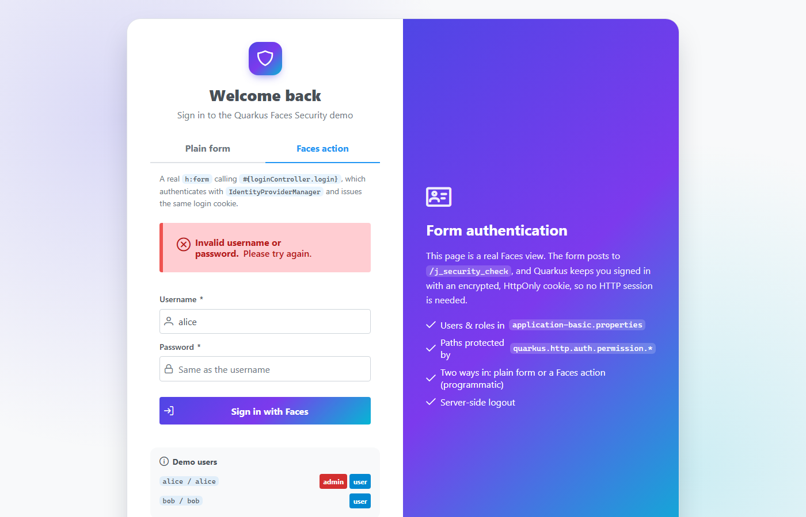

# Quarkus Faces Security Demo

A small [Quarkus](https://quarkus.io) + Jakarta Faces ([MyFaces](https://myfaces.apache.org), [PrimeFaces](https://primefaces.org), [OmniFaces](https://omnifaces.org)) app showing how to secure the **same pages, users and roles** in three ways:

| Command | Mode | What you get |
|---|---|---|
| `mvn quarkus:dev` | **Unsecured** | Only the public home page, with a warning banner. `/secure/**` is blocked. |
| `mvn -Pform` | **Form login** | A PrimeFaces login page (Quarkus form authentication) backed by users in `application-form.properties`. |
| `mvn -Pbasic` | **Basic auth** | No login page. The browser shows its own username/password dialog (HTTP Basic authentication). Users are in `application-basic.properties`. |
| `mvn -Poidc` | **OIDC** | Login through Keycloak, started automatically by Quarkus Dev Services. Same users and roles come from a realm file. |


## Why this exists

People building Faces apps on Quarkus keep asking the same questions
([melloware/quarkus-faces#409](https://github.com/melloware/quarkus-faces/issues/409)):

- *How do I put a real login **page** in front of my Faces views?* Quarkus has no servlet-style `request.login()`, so the usual Jakarta EE answers don't work. The workaround in that ticket (an `HttpClient` that POSTs to `j_security_check` and copies the cookie back) is fragile.
- *How do I log out?*
- *Can I just use the browser's Basic Auth dialog instead?*
- *How do I move to OIDC/Keycloak later without rewriting my pages?*

This repo answers all of them in one place. It builds on the
[OIDC integration wiki page](https://github.com/melloware/quarkus-faces/wiki/OIDC-Integration) and the
[`oidc-auth` branch](https://github.com/melloware/quarkus-faces/tree/oidc-auth) of quarkus-faces.

## Prerequisites

- Java 21+
- Maven 3.9+
- **Docker or Podman** for `-Poidc` and for the full test suite (Keycloak runs in a container).

## Run it

### 1. Unsecured: `mvn quarkus:dev`

Open http://localhost:8080. The home page shows a warning banner and the **User** and **Admin** links are disabled.
If you type a secure URL such as `/secure/user.xhtml` directly, you're redirected home with an explanation. Secure pages are
**never** served without a security profile.


### 2. Form login: `mvn -Pform`

1. Click **Login** or **Open the user page**. Quarkus redirects you to `/login.xhtml`.
2. Sign in as `alice` / `alice` (admin) or `bob` / `bob`, using either tab:
   - **Plain form** posts straight to `/j_security_check`.
   - **Faces action** is a programmatic login from a Faces action method (see [Programmatic login](#programmatic-login-from-a-faces-action)).
3. Quarkus sends you back to the page you asked for.
4. Try the **Admin** console as each user. Bob gets a friendly 403 page.
5. **Logout** clears the login cookie and returns you home.



### 3. Basic auth: `mvn -Pbasic`

1. Click **Login** or **Open the user page**. There's no login page: Quarkus answers `401` with
   `WWW-Authenticate: Basic realm="Quarkus Faces"`, and the **browser** asks for a username and password.
2. Sign in as `alice` / `alice` or `bob` / `bob`. The browser then sends an `Authorization: Basic ...` header with every
   request. There's no cookie and no session.
3. Try the **Admin** console as each user. Bob gets the same friendly 403 page.
4. **Logout** makes the browser forget the credentials (see [HTTP Basic auth](#http-basic-auth) for how, and its limits).



### 4. OIDC: `mvn -Poidc`

Dev Services pulls and starts Keycloak, then imports `src/main/resources/quarkus-faces-realm.json`.
Clicking **Login** now takes you to Keycloak's login screen. Use the same users. **Logout** signs you out of Keycloak too
(RP-initiated logout) and lands back on the home page.



The Keycloak admin console is linked from the Quarkus Dev UI at http://localhost:8080/q/dev-ui.

## Users and roles

The same in all three secured modes:

| User | Password | Roles | User page | Admin console |
|---|---|---|---|---|
| `alice` | `alice` | `admin`, `user` | ✅ | ✅ |
| `bob` | `bob` | `user` | ✅ | ⛔ 403 |

They're defined in `application-form.properties` (form login), `application-basic.properties` (Basic auth) and
`quarkus-faces-realm.json` (OIDC).

## How it works

### Maven profiles + properties files

`application.properties` turns **all** security off. Each Maven profile sets `quarkus.profile`, which layers a
profile-specific properties file on top. Each profile also adds **only the JARs its mode needs**:

```xml
<profile>
    <id>form</id>
    <properties>
        <quarkus.profile>dev,form</quarkus.profile>    <!-- loads application-form.properties -->
    </properties>
    <dependencies>
        <dependency>                                   <!-- embedded users only needed here -->
            <groupId>io.quarkus</groupId>
            <artifactId>quarkus-elytron-security-properties-file</artifactId>
        </dependency>
    </dependencies>
    <build><defaultGoal>clean quarkus:dev</defaultGoal></build>
</profile>
```

| File | Loaded when | Purpose |
|---|---|---|
| `application.properties` | always | `demo.security.mode=none`, form auth off |
| `application-form.properties` | `-Pform` | embedded users, form login settings, path permissions |
| `application-basic.properties` | `-Pbasic` | embedded users, `quarkus.http.auth.basic=true` and realm, path permissions |
| `application-oidc.properties` | `-Poidc` | Keycloak Dev Services, OIDC `web-app` settings, logout, path permissions |

| Build | Security JARs on the classpath |
|---|---|
| default | `quarkus-security` only: there's no way to log in |
| `-Pform` | + `quarkus-elytron-security-properties-file` (Elytron) |
| `-Pbasic` | + `quarkus-elytron-security-properties-file` (Elytron) |
| `-Poidc` | + `quarkus-oidc`, `quarkus-jackson` (SmallRye JWT, MicroProfile JWT API) |

Code that uses OIDC types (`JsonWebToken`) can't compile without those JARs, so it lives in a **separate source folder**,
`src/main/oidc/java`. Only the `oidc` profile adds it, via `build-helper-maven-plugin`. `SecurityService` depends on a small
`TokenClaims` interface. The default `NoTokenClaims` bean (`@DefaultBean`) returns nothing, and `OidcTokenClaims` replaces it
when the OIDC sources are compiled in.

### Path-level security

All three secured profiles use the same HTTP permission rules. Quarkus enforces them in its HTTP layer, **before** the Faces
servlet runs, so `web.xml` has no `<security-constraint>` entries.

```properties
quarkus.http.auth.permission.secure.paths=/secure/*
quarkus.http.auth.permission.secure.policy=authenticated
quarkus.http.auth.policy.admin-only.roles-allowed=admin
quarkus.http.auth.permission.admin.paths=/secure/admin.xhtml
quarkus.http.auth.permission.admin.policy=admin-only
```

Because these 403s never reach Faces, a `web.xml` `<error-page>` can't catch them. `SecurityRoutes` adds a Vert.x failure
handler that redirects them to the styled `access-denied.xhtml` page. In unsecured mode, the same class registers a route that
redirects `/secure/*` to `/index.xhtml?denied=true`.


### One bean that knows the mode: `SecurityService`

Every page talks to `#{securityService}`, never to a specific mechanism:

```xml
<ui:fragment rendered="#{securityService.hasRole('admin')}"> ...admin-only panel... </ui:fragment>
<p:commandButton value="Logout" action="#{securityService.logout}" ajax="false"/>
```

It wraps the injected `SecurityIdentity` (username and roles), plus `TokenClaims` (under OIDC: name, email, issuer).
`logout()` does the right thing for the active mode:

| Mode | Logout |
|---|---|
| form | `FormAuthenticationMechanism.logout(identity)` removes the encrypted `quarkus-credential` cookie, then redirects to `/index.xhtml?logout=true` |
| basic | sets a one-time cookie and redirects to `BasicLogoutServlet`, which answers with a `401` so the browser forgets its cached credentials (see [HTTP Basic auth](#http-basic-auth)) |
| oidc | redirects to the virtual `quarkus.oidc.logout.path` (`/secure/logout`). Quarkus logs you out of Keycloak and returns to `post-logout-path` |

### The Servlet API sees the same user

Quarkus propagates its `SecurityIdentity` into the servlet container, so plain Servlet API calls work in every secured mode.
`WhoAmIServlet` (`/secure/whoami`) prints them, and the user page shows them through EL (`#{request.userPrincipal.name}`):

```
principal=alice                 <- HttpServletRequest#getUserPrincipal().getName()
remoteUser=alice                <- HttpServletRequest#getRemoteUser()
isUserInRole(admin)=true        <- HttpServletRequest#isUserInRole("admin")
isUserInRole(user)=true
```

Under OIDC the principal name is the Keycloak `preferred_username`, so it's `alice`, not a UUID `sub`.

### Form login without `request.login()`

`login.xhtml` is a normal Faces view, but its form is a **plain HTML `<form>`**, not `h:form`. It posts `j_username`
and `j_password` straight to `/j_security_check`, and Quarkus does the rest:

```properties
quarkus.http.auth.form.enabled=true
quarkus.http.auth.form.login-page=/login.xhtml
quarkus.http.auth.form.error-page=/login.xhtml?error=true
quarkus.http.auth.form.landing-page=/secure/user.xhtml
quarkus.http.auth.form.http-only-cookie=true
quarkus.http.auth.session.encryption-key=change-me-...   # use a real secret in production!
```

You stay logged in through an encrypted cookie, not the HTTP session, so it also works across a cluster.

### Programmatic login from a Faces action

People often want the login to be a **Faces action method** instead of a plain form
([quarkus-faces#409](https://github.com/melloware/quarkus-faces/issues/409), [quarkus#27389](https://github.com/quarkusio/quarkus/issues/27389)).
That lets them use PrimeFaces components and validation, `p:messages`, ajax, and their own checks before the login (captcha,
account lockout, auditing). Quarkus has no servlet `request.login()`. The workaround in #409 has the server POST to its own
`/j_security_check` with an `HttpClient` and copy the `Set-Cookie` header back. It's fragile: it breaks with proxies, context
paths and TLS, it depends on Undertow internals, and it doesn't URL-encode the password.

The **Faces action** tab on the login page uses `LoginController` instead, which does in-process what `j_security_check` does:

```java
@Inject IdentityProviderManager identityProviderManager;
@Inject CurrentVertxRequest currentVertxRequest;

public void login() throws IOException {
    // 1. Check the credentials with the same identity providers form auth uses (here: embedded users)
    SecurityIdentity identity = identityProviderManager.authenticateBlocking(
            new UsernamePasswordAuthenticationRequest(username, new PasswordCredential(password.toCharArray())));
    //    -> AuthenticationFailedException on bad credentials: add a FacesMessage and stay on the page

    // 2. Issue the SAME encrypted quarkus-credential cookie, built from the same quarkus.http.auth.form.*
    //    and quarkus.http.auth.session.encryption-key settings
    RoutingContext rc = currentVertxRequest.getCurrent();
    loginManager(http, form).save(identity, rc, null, rc.request().isSSL());

    // 3. Redirect to the page originally asked for (quarkus-redirect-location cookie) or the landing page
    external.redirect(contextPath + redirectTarget(rc, form));
}
```

```xml
<h:form id="progForm">
    <p:messages id="progMessages"/>
    <p:inputText id="username" value="#{loginController.username}" required="true"/>
    <p:password  id="password" value="#{loginController.password}" required="true"/>
    <p:commandButton value="Sign in with Faces" action="#{loginController.login}" process="@form" update="@form"/>
</h:form>
```

The cookie is the same one `j_security_check` creates, so everything after the login works unchanged: path permissions,
`SecurityIdentity`, `getUserPrincipal()`, and logout.

> **Caveat:** `PersistentLoginManager` is a public class in a Quarkus `runtime` package, not a documented API.
> `IdentityProviderManager` is the supported part. Re-run the tests when you upgrade Quarkus; `FormModeProgrammaticLoginTest`
> covers this flow end to end. Programmatic login requires `quarkus.http.auth.session.encryption-key` to be set.



### HTTP Basic auth

The simplest option: no login page, no cookie, no session. Turn it on and Quarkus challenges every unauthenticated
request to a protected path:

```properties
quarkus.http.auth.basic=true
quarkus.http.auth.realm=Quarkus Faces     # shown in some browsers' dialogs
```

```
GET /secure/user.xhtml                      ->  401  WWW-Authenticate: basic realm="Quarkus Faces"
GET /secure/user.xhtml                      ->  200  (the browser retries after the user fills in its dialog)
Authorization: Basic YWxpY2U6YWxpY2U=
```

The Faces pages don't change at all: `SecurityIdentity`, `#{securityService...}`, path permissions,
`getUserPrincipal()` and the friendly 403 page all work exactly as with form login.

Things to know before you pick it:

- **The password goes with every request**, only base64-encoded. Use HTTPS.
- **You can't style the dialog**, add a "remember me", a captcha or a Faces message. Use form login for that.
- **The browser decides when to send the credentials.** It resends them automatically only under the path it was
  challenged on (here `/secure/`). Public pages such as the home page get no `Authorization` header, so they show you as
  signed out. Click **Login** again and you're straight back in, with no dialog.
- **There's no logout in the protocol.** The browser keeps the credentials until it is closed. The demo uses the usual
  workaround: **Logout** sets a one-time cookie and redirects to `BasicLogoutServlet` (`/secure/basic-logout`), which
  answers the cached credentials with a `401` and a new challenge. The browser treats them as rejected, forgets them
  and shows its dialog again. Click **Cancel** and you land on the home page, signed out. If you type the credentials
  in again instead, the cookie is gone, so you're simply signed back in.

### OIDC notes

- Keycloak puts realm roles in the **access** token, so `quarkus.oidc.roles.source=accesstoken`.
- `quarkus.oidc.token-state-manager.split-tokens=true` is needed because the ID, access and refresh tokens together are too big for one cookie.
- `quarkus-jackson` is in the `oidc` profile because OIDC needs Jackson to read Keycloak's JSON metadata.
- For production, set `quarkus.oidc.auth-server-url` to your real Keycloak realm and supply the client secret through an environment variable.


## Tests

Each mode has different JARs on the classpath, so each mode is tested in its **own build**:

```bash
mvn verify            # unsecured mode tests
mvn -Pform verify     # form login tests
mvn -Pbasic verify    # Basic auth tests
mvn -Poidc verify     # OIDC tests - needs Docker running

# everything, e.g. in CI
mvn verify && mvn -Pform verify && mvn -Pbasic verify && mvn -Poidc verify
```

Tests are tagged with JUnit 5 `@Tag("unsecured" | "form" | "basic" | "oidc")`. Each Maven profile sets surefire's `groups` to
its tag. Each test class also selects its configuration through a `QuarkusTestProfile` (`FormProfile`, `BasicProfile`,
`OidcProfile`; the unsecured tests use the default profile).

| Test | Build | What it checks |
|---|---|---|
| `UnsecuredModeTest` | `mvn verify` | warning banner; `/secure/**` redirects home with an explanation |
| `FormModeTest` | `-Pform` | RestAssured: redirect to login, `j_security_check` cookie, role-based content, 403 page, bad password, **`getUserPrincipal()` / `isUserInRole()`** |
| `FormModeBrowserTest` | `-Pform` | [Quarkus Playwright](https://docs.quarkiverse.io/quarkus-playwright/dev/): full login, admin access, bob denied, logout |
| `FormModeProgrammaticLoginTest` | `-Pform` | Playwright: Faces-action login returns to the original page, landing page, `getUserPrincipal()`, wrong password and required-field messages, logout |
| `BasicModeTest` | `-Pbasic` | RestAssured: `401` + `WWW-Authenticate` challenge, no form login, role-based content, 403 page, bad password, **`getUserPrincipal()` / `isUserInRole()`**, logout `401` |
| `BasicModeBrowserTest` | `-Pbasic` | Playwright with `httpCredentials` (a headless browser can't type into the native dialog): challenge, admin access, bob denied, logout |
| `OidcModeTest` | `-Poidc` | redirect to Keycloak's authorize endpoint |
| `OidcModeBrowserTest` | `-Poidc` | Playwright drives the Keycloak login form, checks roles, **`getUserPrincipal()` / `isUserInRole()`**, then single logout |

The OIDC tests **fail** (they're not skipped) if Docker isn't available. Playwright downloads its browser on the first run.

### Native mode

Each test class has an `*IT` subclass (`@QuarkusIntegrationTest`). Failsafe runs these against the native executable when
the `native` profile is active (`-Dnative`). They're skipped in a normal build.

```bash
mvn verify -Dnative -Dnative.surefire.skip            # unsecured, native
mvn -Pform verify -Dnative -Dnative.surefire.skip     # form login, native
mvn -Pbasic verify -Dnative -Dnative.surefire.skip    # Basic auth, native
mvn -Poidc verify -Dnative -Dnative.surefire.skip     # OIDC, native - needs Docker
# no local GraalVM/Mandrel? build inside a container (Linux only, since the ITs then run a Linux binary):
#   ... -Dquarkus.native.container-build=true
```

The `*IT` tests start Keycloak Dev Services from the test JVM, which doesn't read `application-oidc.properties`.
So the `oidc` Maven profile passes the realm and client settings to failsafe as system properties. Keep them in sync.

Native gotchas this demo runs into (and the native tests guard against):
- EL reads properties by reflection. A plain POJO such as `DemoUser` needs `@RegisterForReflection`. Method calls on JDK or
  container objects (`#{list.size()}`, `#{request.userPrincipal.name}`) fail in native, so expose a bean getter instead.
- The image must be built with the mode's config profile (`form`/`basic`/`oidc`), not the `dev,form` that `quarkus:dev` uses.
  The `native` Maven profile takes care of this.

### CI

`.github/workflows/build.yml` runs on every pull request and every push to `main`. For each mode it runs the JVM tests
on Ubuntu (unsecured, form and basic also run on Windows) and builds a native executable with GraalVM to run the `*IT` tests.

## Use the pattern in your own app

1. Copy `application.properties`, the properties file of each mode you want, and the matching `form` / `basic` / `oidc`
   Maven profiles (dependencies and, for OIDC, the extra source folder).
2. Put protected views under `/secure/` (or change `quarkus.http.auth.permission.*.paths`).
3. For form login, copy `login.xhtml`. Either keep the plain `<form action="j_security_check">` with `j_username` /
   `j_password`, or use the Faces-action version with `LoginController` for a programmatic login.
   For Basic auth there's no page to copy; add `BasicLogoutServlet` if you want a logout button.
4. Copy `SecurityService` and have your pages use only `#{securityService...}`.
5. Optionally copy `SecurityRoutes` for friendly 403 and unsecured-mode handling.

## Project layout

```
src/main/java/com/melloware/faces/security/        shared by every mode
  SecurityService.java     the only class that knows the active mode
  TokenClaims.java         claims abstraction (NoTokenClaims = default bean)
  WhoAmIServlet.java       /secure/whoami - plain Servlet API getUserPrincipal()/isUserInRole()
  SecurityRoutes.java      Vert.x routes: unsecured-mode guard + friendly 403
  ThemeBean.java           light/dark toggle (saga-blue / arya-blue)
  DemoUser(s).java         display data for the users table
  form/LoginController.java      -Pform: programmatic login from a Faces action (IdentityProviderManager + form-auth cookie)
  basic/BasicLogoutServlet.java  -Pbasic: /secure/basic-logout - makes the browser forget its Basic auth credentials
src/main/oidc/java/com/melloware/faces/security/
  oidc/OidcTokenClaims.java      -Poidc: token claims - this source folder is compiled only by -Poidc
src/test/java/com/melloware/faces/security/
  UnsecuredMode*.java      default build
  form/, basic/, oidc/     each mode's tests (*Test + *IT)
  profiles/                QuarkusTestProfile per mode
src/main/resources/
  application*.properties  base + form + basic + oidc
  quarkus-faces-realm.json Keycloak realm for Dev Services
  META-INF/resources/      index, login, access-denied, secure/user, secure/admin, WEB-INF/template
```

## License

MIT
