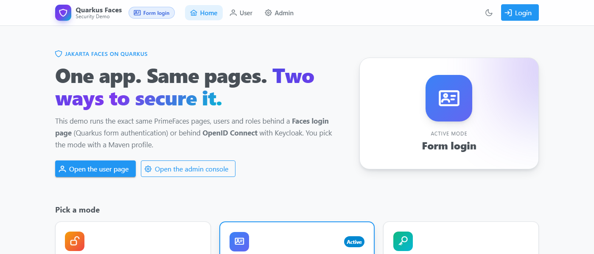
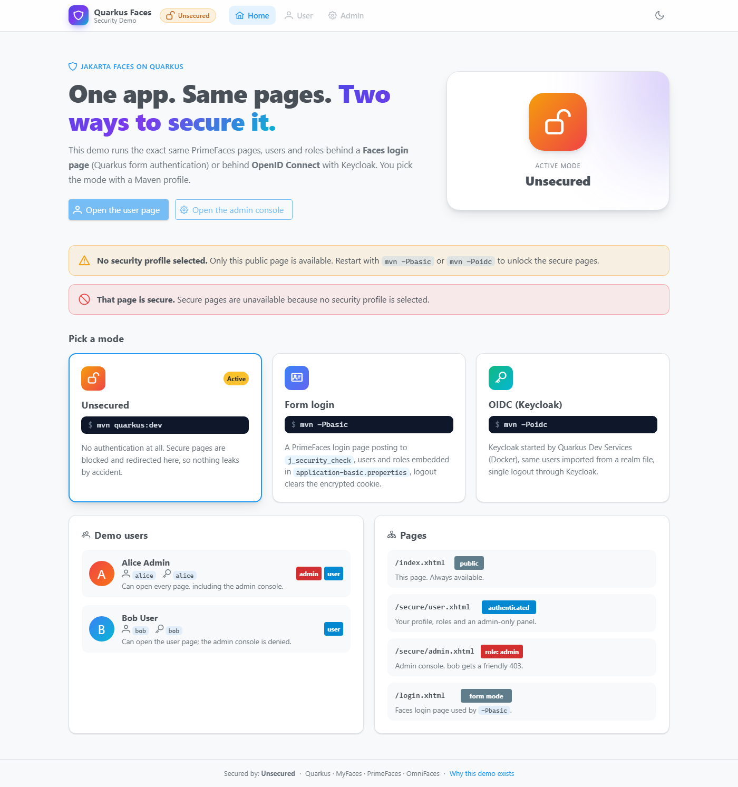
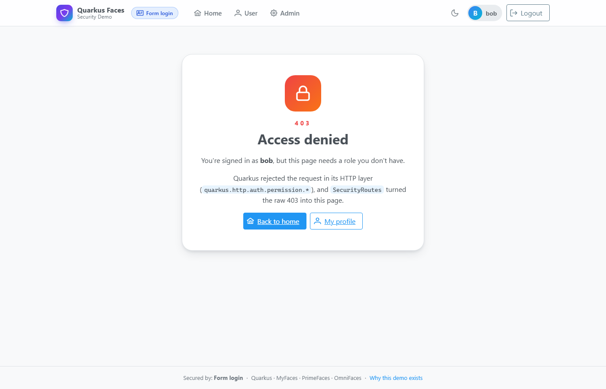
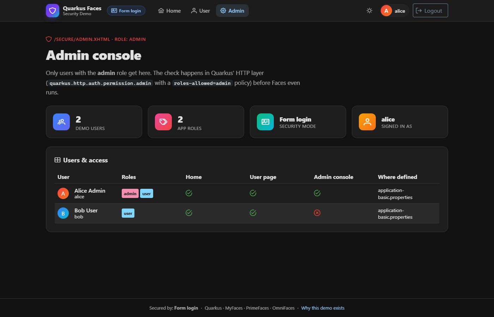

# Quarkus Faces Security Demo

A small [Quarkus](https://quarkus.io) + Jakarta Faces ([MyFaces](https://myfaces.apache.org), [PrimeFaces](https://primefaces.org), [OmniFaces](https://omnifaces.org)) app showing how to secure the **same pages, users and roles** in two ways:

| Command | Mode | What you get |
|---|---|---|
| `mvn quarkus:dev` | **Unsecured** | Only the public home page, with a warning banner. `/secure/**` is blocked. |
| `mvn -Pbasic` | **Form login** | A PrimeFaces login page (Quarkus form authentication) backed by users in `application-basic.properties`. |
| `mvn -Poidc` | **OIDC** | Login through Keycloak, started automatically by Quarkus Dev Services. Same users and roles come from a realm file. |



## Why this exists

People building Faces apps on Quarkus keep asking the same questions
([melloware/quarkus-faces#409](https://github.com/melloware/quarkus-faces/issues/409)):

- *How do I put a real login **page** in front of my Faces views?* Quarkus has no servlet-style `request.login()`, so the usual Jakarta EE answers don't work. The workaround in that ticket (an `HttpClient` that POSTs to `j_security_check` and copies the cookie back) is fragile.
- *How do I log out?*
- *How do I move to OIDC/Keycloak later without rewriting my pages?*

This repo answers all three in one place. It builds on the
[OIDC integration wiki page](https://github.com/melloware/quarkus-faces/wiki/OIDC-Integration) and the
[`oidc-auth` branch](https://github.com/melloware/quarkus-faces/tree/oidc-auth) of quarkus-faces.

## Prerequisites

- Java 21+
- Maven 3.9+
- **Docker or Podman** for `-Poidc` and for the full test suite (Keycloak runs in a container).

## Run it

### 1. Unsecured: `mvn quarkus:dev`

Open http://localhost:8080. The home page shows a warning banner and the **User** and **Admin** links are disabled.
If you type a secure URL such as `/secure/user.xhtml` directly, you're redirected home with an explanation. Secure pages are
**never** served without a security profile.



### 2. Form login: `mvn -Pbasic`

1. Click **Login** or **Open the user page**. Quarkus redirects you to `/login.xhtml`.
2. Sign in as `alice` / `alice` (admin) or `bob` / `bob`.
3. Quarkus sends you back to the page you asked for.
4. Try the **Admin** console as each user. Bob gets a friendly 403 page.
5. **Logout** clears the login cookie and returns you home.


### 3. OIDC: `mvn -Poidc`

Dev Services pulls and starts Keycloak, then imports `src/main/resources/quarkus-faces-realm.json`.
Clicking **Login** now takes you to Keycloak's login screen. Use the same users. **Logout** signs you out of Keycloak too
(RP-initiated logout) and lands back on the home page.


The Keycloak admin console is linked from the Quarkus Dev UI at http://localhost:8080/q/dev-ui.

## Users and roles

The same in both secured modes:

| User | Password | Roles | User page | Admin console |
|---|---|---|---|---|
| `alice` | `alice` | `admin`, `user` | ✅ | ✅ |
| `bob` | `bob` | `user` | ✅ | ⛔ 403 |

They're defined in `application-basic.properties` (form login) and `quarkus-faces-realm.json` (OIDC).

## How it works

### Maven profiles + properties files

`application.properties` turns **all** security off. Each Maven profile sets `quarkus.profile`, which layers a
profile-specific properties file on top. Each profile also adds **only the JARs its mode needs**:

```xml
<profile>
    <id>basic</id>
    <properties>
        <quarkus.profile>dev,basic</quarkus.profile>   <!-- loads application-basic.properties -->
    </properties>
    <dependencies>
        <dependency>                                   <!-- embedded users only needed here -->
            <groupId>io.quarkus</groupId>
            <artifactId>quarkus-elytron-security-properties-file</artifactId>
        </dependency>
    </dependencies>
    <build><defaultGoal>clean quarkus:dev</defaultGoal></build>
</profile>
```

| File | Loaded when | Purpose |
|---|---|---|
| `application.properties` | always | `demo.security.mode=none`, form auth off |
| `application-basic.properties` | `-Pbasic` | embedded users, form login settings, path permissions |
| `application-oidc.properties` | `-Poidc` | Keycloak Dev Services, OIDC `web-app` settings, logout, path permissions |

| Build | Security JARs on the classpath |
|---|---|
| default | `quarkus-security` only: there's no way to log in |
| `-Pbasic` | + `quarkus-elytron-security-properties-file` (Elytron) |
| `-Poidc` | + `quarkus-oidc`, `quarkus-jackson` (SmallRye JWT, MicroProfile JWT API) |

Code that uses OIDC types (`JsonWebToken`) can't compile without those JARs, so it lives in a **separate source folder**,
`src/main/oidc/java`. Only the `oidc` profile adds it, via `build-helper-maven-plugin`. `SecurityService` depends on a small
`TokenClaims` interface. The default `NoTokenClaims` bean (`@DefaultBean`) returns nothing, and `OidcTokenClaims` replaces it
when the OIDC sources are compiled in.

### Path-level security

Both secured profiles use the same HTTP permission rules. Quarkus enforces them in its HTTP layer, **before** the Faces
servlet runs, so `web.xml` has no `<security-constraint>` entries.

```properties
quarkus.http.auth.permission.secure.paths=/secure/*
quarkus.http.auth.permission.secure.policy=authenticated
quarkus.http.auth.policy.admin-only.roles-allowed=admin
quarkus.http.auth.permission.admin.paths=/secure/admin.xhtml
quarkus.http.auth.permission.admin.policy=admin-only
```

Because these 403s never reach Faces, a `web.xml` `<error-page>` can't catch them. `SecurityRoutes` adds a Vert.x failure
handler that redirects them to the styled `access-denied.xhtml` page. In unsecured mode, the same class registers a route that
redirects `/secure/*` to `/index.xhtml?denied=true`.



### One bean that knows the mode: `SecurityService`

Every page talks to `#{securityService}`, never to a specific mechanism:

```xml
<ui:fragment rendered="#{securityService.hasRole('admin')}"> ...admin-only panel... </ui:fragment>
<p:commandButton value="Logout" action="#{securityService.logout}" ajax="false"/>
```

It wraps the injected `SecurityIdentity` (username and roles), plus `TokenClaims` (under OIDC: name, email, issuer).
`logout()` does the right thing for the active mode:

| Mode | Logout |
|---|---|
| basic | `FormAuthenticationMechanism.logout(identity)` removes the encrypted `quarkus-credential` cookie, then redirects to `/index.xhtml?logout=true` |
| oidc | redirects to the virtual `quarkus.oidc.logout.path` (`/secure/logout`). Quarkus logs you out of Keycloak and returns to `post-logout-path` |

### The Servlet API sees the same user

Quarkus propagates its `SecurityIdentity` into the servlet container, so plain Servlet API calls work in both modes.
`WhoAmIServlet` (`/secure/whoami`) prints them, and the user page shows them through EL (`#{request.userPrincipal.name}`):

```
principal=alice                 <- HttpServletRequest#getUserPrincipal().getName()
remoteUser=alice                <- HttpServletRequest#getRemoteUser()
isUserInRole(admin)=true        <- HttpServletRequest#isUserInRole("admin")
isUserInRole(user)=true
```

Under OIDC the principal name is the Keycloak `preferred_username`, so it's `alice`, not a UUID `sub`.

### Form login without `request.login()`

`login.xhtml` is a normal Faces view, but its form is a **plain HTML `<form>`**, not `h:form`. It posts `j_username`
and `j_password` straight to `/j_security_check`, and Quarkus does the rest:

```properties
quarkus.http.auth.form.enabled=true
quarkus.http.auth.form.login-page=/login.xhtml
quarkus.http.auth.form.error-page=/login.xhtml?error=true
quarkus.http.auth.form.landing-page=/secure/user.xhtml
quarkus.http.auth.form.http-only-cookie=true
quarkus.http.auth.session.encryption-key=change-me-...   # use a real secret in production!
```

You stay logged in through an encrypted cookie, not the HTTP session, so it also works across a cluster.

### OIDC notes

- Keycloak puts realm roles in the **access** token, so `quarkus.oidc.roles.source=accesstoken`.
- `quarkus.oidc.token-state-manager.split-tokens=true` is needed because the ID, access and refresh tokens together are too big for one cookie.
- `quarkus-jackson` is in the `oidc` profile because OIDC needs Jackson to read Keycloak's JSON metadata.
- For production, set `quarkus.oidc.auth-server-url` to your real Keycloak realm and supply the client secret through an environment variable.



## Tests

Each mode has different JARs on the classpath, so each mode is tested in its **own build**:

```bash
mvn verify            # unsecured mode tests
mvn -Pbasic verify    # form login tests
mvn -Poidc verify     # OIDC tests - needs Docker running

# everything, e.g. in CI
mvn verify && mvn -Pbasic verify && mvn -Poidc verify
```

Tests are tagged with JUnit 5 `@Tag("unsecured" | "basic" | "oidc")`. Each Maven profile sets surefire's `groups` to its tag.
Each test class also selects its configuration through a `QuarkusTestProfile` (`BasicProfile`, `OidcProfile`; the unsecured
tests use the default profile).

| Test | Build | What it checks |
|---|---|---|
| `UnsecuredModeTest` | `mvn verify` | warning banner; `/secure/**` redirects home with an explanation |
| `BasicModeTest` | `-Pbasic` | RestAssured: redirect to login, `j_security_check` cookie, role-based content, 403 page, bad password, **`getUserPrincipal()` / `isUserInRole()`** |
| `BasicModeBrowserTest` | `-Pbasic` | [Quarkus Playwright](https://docs.quarkiverse.io/quarkus-playwright/dev/): full login, admin access, bob denied, logout |
| `OidcModeTest` | `-Poidc` | redirect to Keycloak's authorize endpoint |
| `OidcModeBrowserTest` | `-Poidc` | Playwright drives the Keycloak login form, checks roles, **`getUserPrincipal()` / `isUserInRole()`**, then single logout |

The OIDC tests **fail** (they're not skipped) if Docker isn't available. Playwright downloads its browser on the first run.

## Use the pattern in your own app

1. Copy the three properties files and the `basic` / `oidc` Maven profiles (dependencies and, for OIDC, the extra source folder).
2. Put protected views under `/secure/` (or change `quarkus.http.auth.permission.*.paths`).
3. Copy `login.xhtml`, keeping the plain `<form action="j_security_check">` with `j_username` / `j_password`.
4. Copy `SecurityService` and have your pages use only `#{securityService...}`.
5. Optionally copy `SecurityRoutes` for friendly 403 and unsecured-mode handling.

## Project layout

```
src/main/java/com/melloware/faces/security/
  SecurityService.java     the only class that knows the active mode
  TokenClaims.java         claims abstraction (NoTokenClaims = default bean)
  WhoAmIServlet.java       /secure/whoami - plain Servlet API getUserPrincipal()/isUserInRole()
  SecurityRoutes.java      Vert.x routes: unsecured-mode guard + friendly 403
src/main/oidc/java/...     OidcTokenClaims - compiled only by -Poidc
  ThemeBean.java           light/dark toggle (saga-blue / arya-blue)
  DemoUser(s).java         display data for the users table
src/main/resources/
  application*.properties  base + basic + oidc
  quarkus-faces-realm.json Keycloak realm for Dev Services
  META-INF/resources/      index, login, access-denied, secure/user, secure/admin, WEB-INF/template
```

## License

MIT
